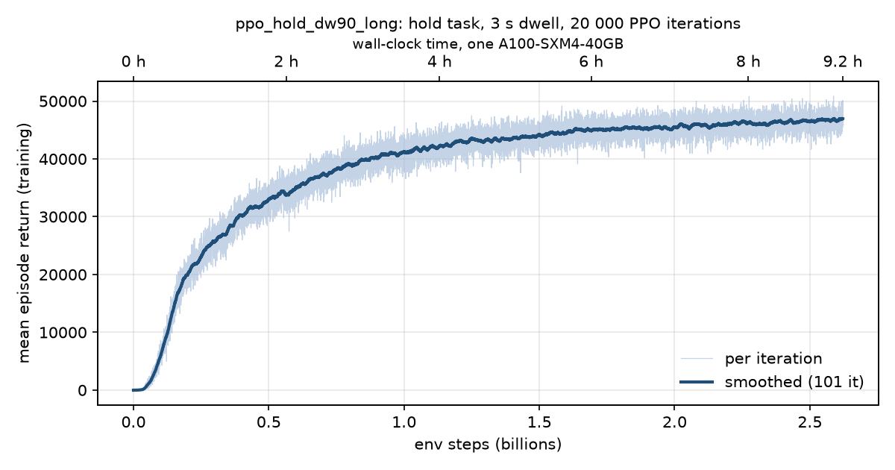

# Results

Fixed-wrist Allegro cube repose (`docs/ENVIRONMENT.md`), PPO (`docs/METHOD.md`), one A100-40GB per
run, 10 000 iterations (1.31 B env steps) unless noted. Final numbers: 4096 deterministic 10 s
episodes (`scripts/evaluate.py`); the JSON files are in `docs/evals/`, the videos in `docs/videos/`
(30 s of simulation; `_slow` = half speed).

## Summary

| policy | config | held goals / episode (1 s rule) | time on goal | drops | own rule |
|---|---|---|---|---|---|
| `ppo_s0`, `ppo_s1` | Isaac Lab task | 0.12 / 0.11 | 31 / 24 % | 9 / 11 % | 11.27 / 9.50 goals touched, 21.8 / 24.5 % drops |
| `ppo_hold_s0`, `_s1` | hold, 1 s dwell | 1.84 / 1.79 | 47 / 44 % | 22 / 27 % | same rule |
| `ppo_hold_dw60`, `_s1` | hold, 2 s dwell | 2.54 / 2.58 | 40 / 39 % | 26 / 26 % | 1.46 / 1.52 two-second holds, 54 % on goal, 19 % drops |
| **`ppo_hold_dw90`**, `_s1` | **hold, 3 s dwell** | **2.61** / 2.49 | 39 / 37 % | 26 / 29 % | **1.13 / 1.12 three-second holds, 60 / 59 % on goal, 16 / 18 % drops** |
| `ppo_hold_dw120` | hold, 4 s dwell | 2.50 | 37 % | 32 % | 0.80 four-second holds, 62 % on goal, 17 % drops |
| **`ppo_hold_dw90_long`** | **hold, 3 s dwell, 20 000 iterations** | **2.83** | 41 % | 25 % | **1.21 three-second holds, 62 % on goal, 15 % drops** |

**Recommended: the hold design with a 3 s dwell** (`--task allegro_repose_hold task.goal.dwell_steps=90`).
It holds the cube on the goal 60 % of the time with the fewest drops; a longer dwell gains little and
copes worse with frequent goal changes. Training it twice as long (20 000 iterations, 2.6 B steps,
9.2 h; `algo.max_iterations=20000`) improves every metric: 62 % on goal, 15 % drops, and 2.83 goals held
1 s per episode under the common rule (best of all runs). Video: `ppo_hold_dw90_long_slow.mp4`.

*Mean training episode return of `ppo_hold_dw90_long` (8192 parallel envs, one A100-40GB, 9.2 h for
20 000 iterations).*

## Isaac Lab task (`configs/task/allegro_repose.yaml`)

| run | env steps | training time | goals / episode | median | fall rate | video |
|---|---|---|---|---|---|---|
| ppo_s0 | 1.31 B | 3.7 h | 11.27 | 12 | 21.8 % | `ppo_s0.mp4`, `ppo_s0_slow_hold.mp4` |
| ppo_s1 | 1.31 B | 3.3 h | 9.50 | 10 | 24.5 % | `ppo_s1.mp4`, `ppo_s1_slow_hold.mp4` |

Learning is fast (6-7 goals per episode at 0.5 B steps, about 100 000 env steps/s). The policy
reaches goals but does not stay on them: the task draws a new goal the step the cube first enters
the 0.2 rad tolerance, so nothing rewards holding a pose. Scored with a 1 s hold rule
(`--set task.goal.dwell_steps=30`), it completes only 0.11-0.12 goals per episode. The `_slow_hold`
videos keep each reached goal on screen for 2 s for viewing; the policy keeps turning the cube.

## Hold design (`configs/task/allegro_repose_hold.yaml`)

A goal counts only after a dwell within tolerance; the reach bonus is paid on every step on goal;
the orientation reward is flat within 0.31 rad of the goal; large per-step changes of the joint
targets are penalized; the actor sees rotation-6D orientations and no velocities, the critic also
gets privileged velocities (`docs/ENVIRONMENT.md`, "Hold variant").

**1 s dwell** (`ppo_hold_s0`, `ppo_hold_s1`): 1.84 / 1.79 held goals, 47 / 44 % time on goal,
22 / 27 % drops (Isaac Lab policies under the same rule: 0.12 / 0.11, 31 / 24 %, 9 / 11 %). The hold
policies drop the cube more often because they keep reorienting toward new goals, while the Isaac
Lab policies, under a dwell, hover near one goal they cannot settle on.

**Controls.**

* Observation only (`ppo_r6d_s0`: the hold design's observation with Isaac Lab's reward): 7.80
  goals touched per episode, 38.5 % drops; 0.28 held goals under the 1 s rule. The observation
  alone does not produce holding; the reward and dwell do.
* Fall penalty (`ppo_hold_f100`: 1 s dwell and -100 on a fall): 1.78 held goals, 45 % on goal,
  25 % drops, the same as without the penalty.

**Dwell length** (each policy scored with its own dwell; "1 s rule" = all scored with a 1 s dwell):

| dwell in training | seeds | time on goal | drops | held goals, 1 s rule (drops) | video |
|---|---|---|---|---|---|
| 1 s | 2 | 44-47 % | 22-27 % | 1.79-1.84 (22-27 %) | `ppo_hold_s0_slow.mp4`, `ppo_hold_s1_slow.mp4` |
| 2 s | 2 | 54 % | 19 % | 2.54-2.58 (26 %) | `ppo_hold_dw60_slow.mp4` |
| 3 s | 2 | 59-60 % | 16-18 % | 2.49-2.61 (26-29 %) | `ppo_hold_dw90_slow.mp4`, `ppo_hold_dw90_s1_slow.mp4` |
| 4 s | 1 | 62 % | 17 % | 2.50 (32 %) | `ppo_hold_dw120_slow.mp4` |

A longer dwell in training gives a steadier policy, even when scored under the shorter rule; the
gain levels off between 3 s and 4 s. The 3 s dwell second seed (`ppo_hold_dw90_s1`) and a
20 000-iteration run of the 3 s design (`ppo_hold_dw90_long`) are listed below.

## Additional runs

| run | status | result |
|---|---|---|
| `ppo_hold_dw90_s1` | done (4.4 h) | 1.12 three-second holds, 59 % on goal, 18 % drops: reproduces seed 0. Video: 5 holds, 1 drop |
| `ppo_hold_dw90_long` | done (20 000 iterations, 2.62 B steps, 9.2 h) | 1.21 three-second holds, 62 % on goal, 15 % drops; 1 s rule 2.83 held, 25 % drops. Video: 5 holds, 0 drops |
